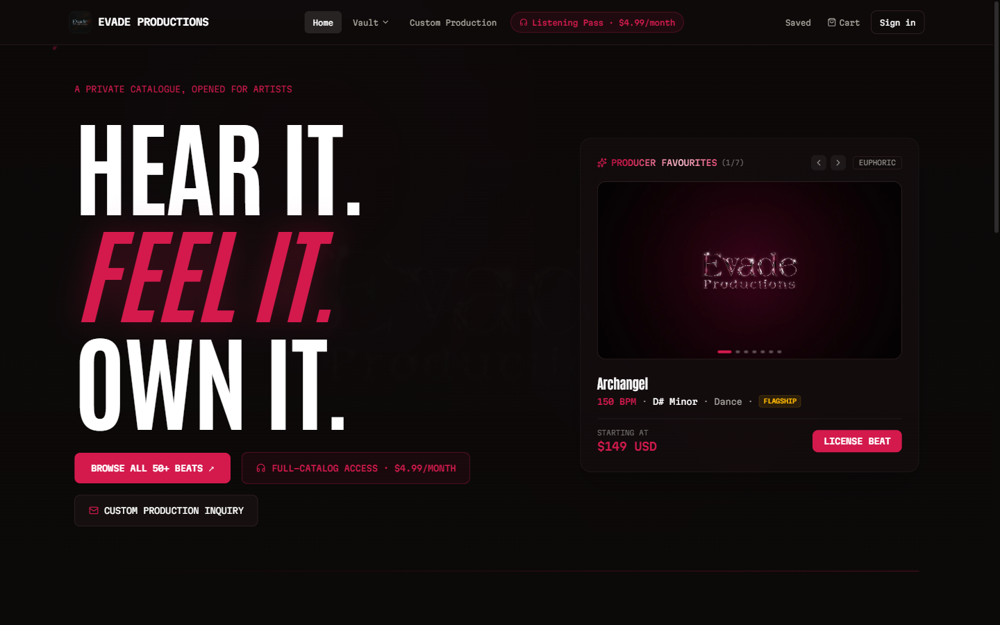
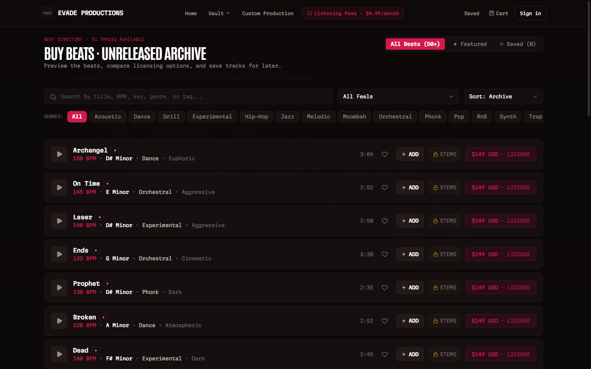
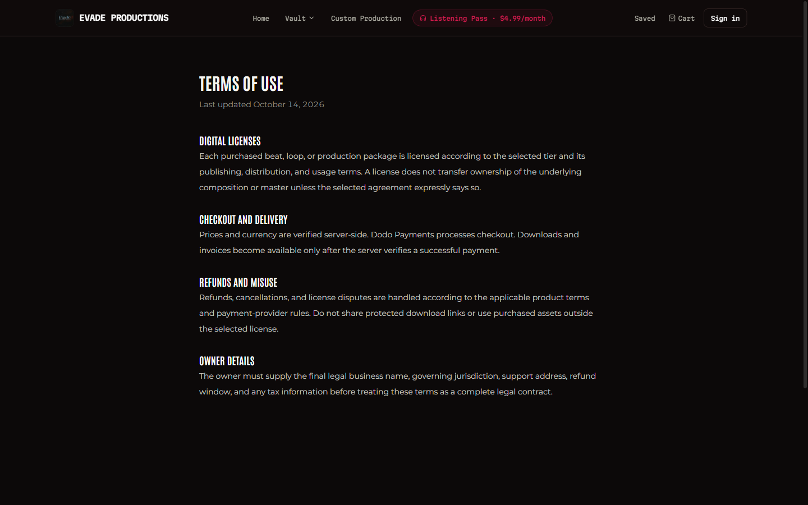
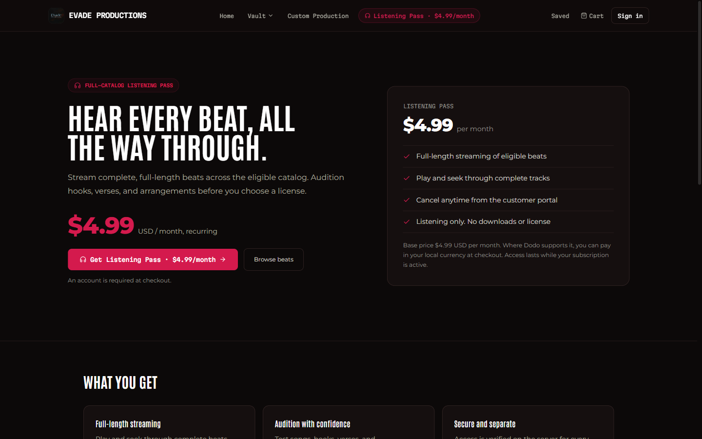
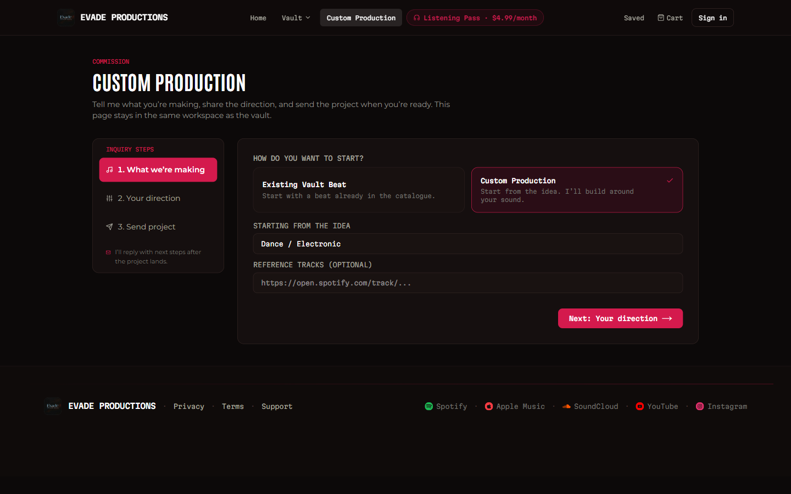
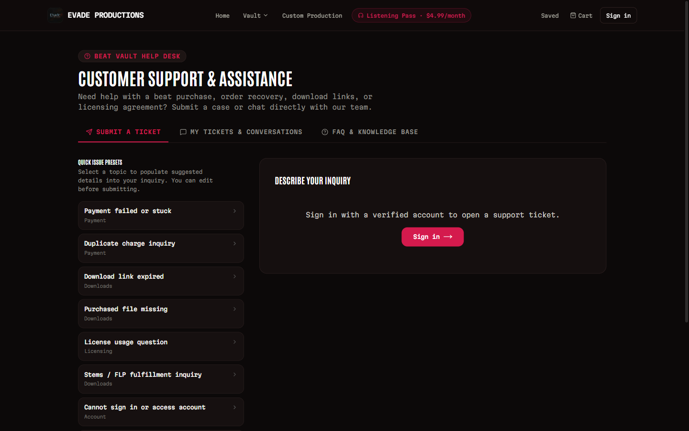
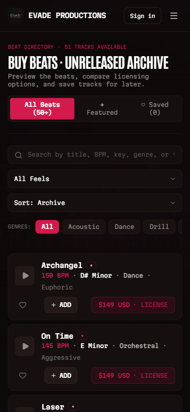

# Evade Productions: Beat Vault

**Live site:** [evadeproductions.com](https://evadeproductions.com)

Beat Vault is the home of Evade Productions, a producer storefront where artists can discover, preview and license original beats, request custom production, and get their files delivered fast.

> This repository is a public showcase. The source code is private and all rights are reserved.

## Quick start guide

### 1. Find a beat

Open the [beat directory](https://evadeproductions.com/beats). Search by title, BPM, key, genre or tag, filter by genre or feel, and sort the list. Tap the heart on any beat to save it for later.

### 2. Listen to a preview

Press play on any beat to hear a short public preview. A **PREVIEW** badge shows while you listen, and the progress bar reflects the preview length, not the full track. When it ends you can replay it or choose a license or the Listening Pass.

### 3. Choose a license

Each beat shows its starting license price. Open the license options to compare tiers in plain terms, including what you can release, and which tiers include stems and project files. Read the [license terms](https://evadeproductions.com/terms) before you buy.

### 4. Check out

Add beats to your cart, sign in, and pay securely online. You need an account so that your purchases and license stay tied to you.

### 5. Get your files

After payment you receive your license and download links in your account and by email. Tiers that include stems or project files are delivered within 48 hours. If a link expires, generate a fresh one from your account at any time.

### 6. Exclusive rights

If you buy a beat exclusively, it is removed from the catalog so nobody else can license it.

## Full-Catalog Listening Pass

Want to audition more than previews? The [Listening Pass](https://evadeproductions.com/listening-pass) is a separate monthly membership at $4.99 per month. It lets you stream complete tracks across the catalog to test hooks, verses and arrangements. You can cancel any time from your subscription page.

It is listening only. It does not include downloads, stems, project files, ownership or any right to release music made with a beat. To use a beat in a release you still need a license.

## Custom production

Need something made for you? Use the [custom production](https://evadeproductions.com/customproduction) page to describe your project. You will get a reply with a quote, and you can pay online when you are ready to start.

## Your account

Sign in from the top right of any page. Your account holds your purchases, licenses, downloads and saved beats. Create an account with your email and verify it to unlock support.

## Getting help

Open the [support page](https://evadeproductions.com/support). Support tickets need a signed-in account with a verified email.

1. Sign in and open a new ticket.
2. You get an email with your ticket reference and a link to the ticket.
3. Follow replies and respond from **My Support Tickets** in your account. Replies are made in the account, not by email.
4. Email notifications tell you when we answer or need more information.

## On your phone

The whole site works on mobile, including browsing, previews, cart and your account.

## Built for trust

- Clear license terms for every tier, with a verifiable license for each purchase.
- Secure checkout and private file delivery.
- Verified accounts for support, so your conversations stay yours.

## Contact

- Business and support: [support@evadeproductions.com](mailto:support@evadeproductions.com)
- Music: [Spotify](https://open.spotify.com/artist/6LXXFuvj6irAbI0bn5tQWz) · [Apple Music](https://music.apple.com/in/artist/evade-productions/1622711147) · [SoundCloud](https://soundcloud.com/evadeproductionsofficial) · [YouTube](https://youtube.com/@EvadeProductions) · [Instagram](https://instagram.com/evadeproductionsofficial)

## License

Copyright (c) Evade Productions. All rights reserved. No part of this project, its design, content or code may be copied, reproduced or used without written permission.
